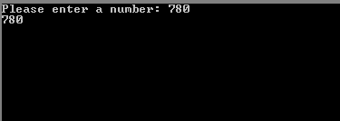
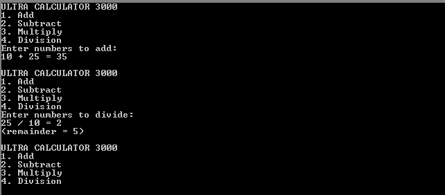

# Demo Program Assembly Organisasi Komputer
Program-program ini merupakan demonstrasi kemampuan aritmatika pada bahasa pemrograman assembly.

## nameinput_demo.asm
Program ini mendemonstrasikan cara mengambil input dari pengguna, dan juga mengoutputkannya.

## numberinput_demo.asm
Program ini merupakan tambahan dari program sebelumnya, mendemonstrasikan cara mengambil input dari pengguna dan mengonversikannya menjadi bentuk data angka sehingga bisa diproses.  

## calculator.asm
Program ini merupakan tujuan dan target akhir dari materi ini. Program bisa mengambil input pengguna, melakukan konversi input ke bilangan, serta melakukan perhitungan aritmatik dan mengoutputkan hasilnya.

